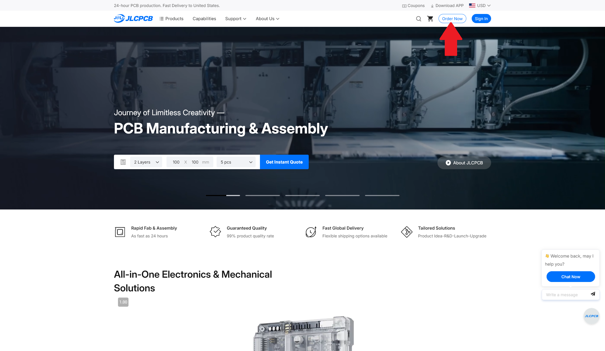
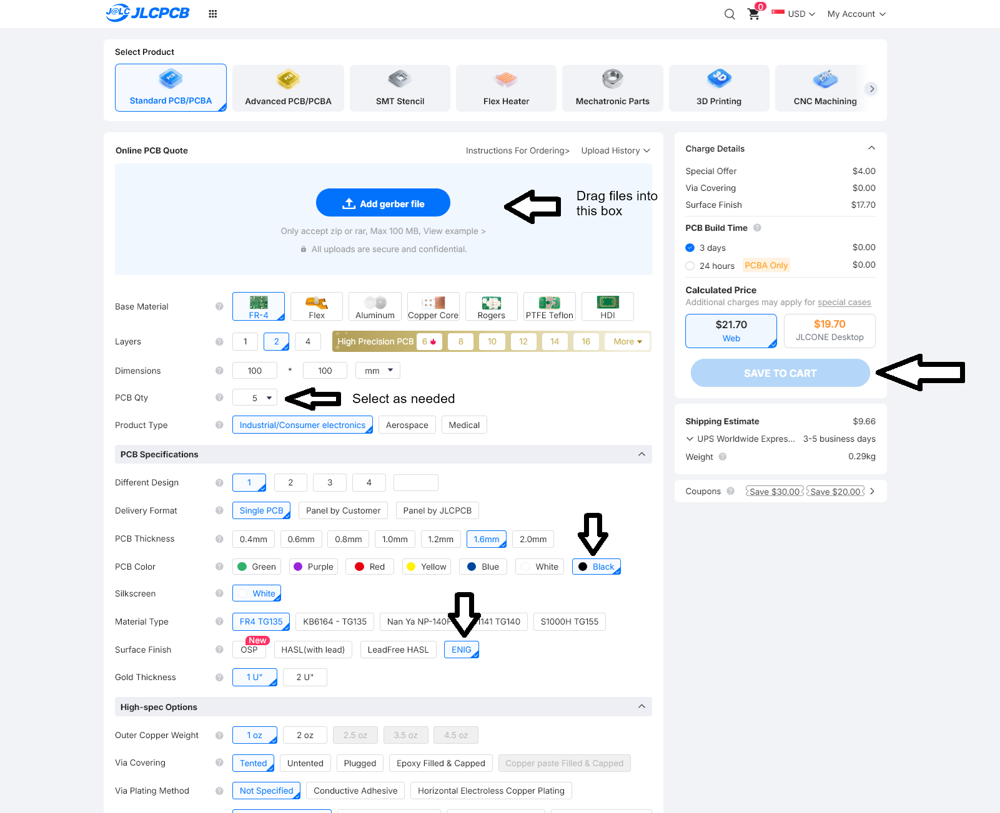
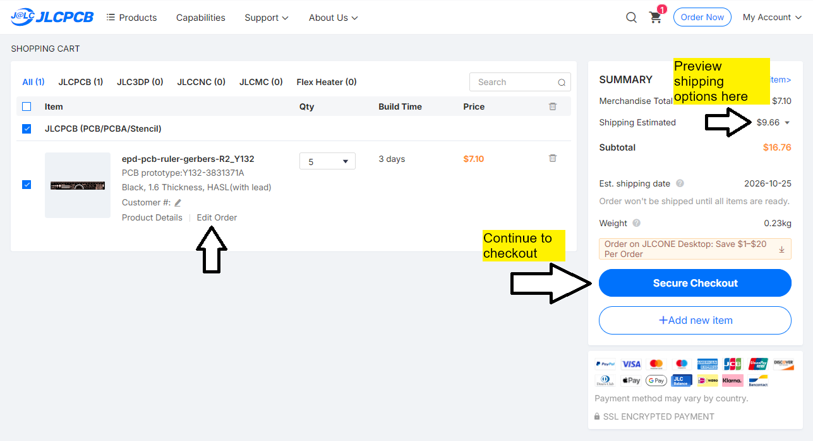
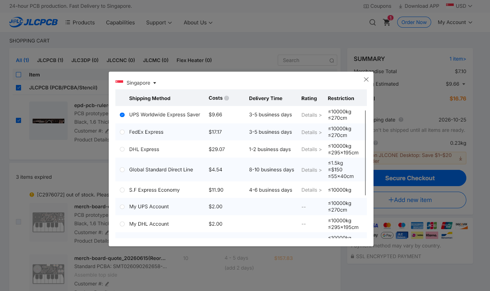
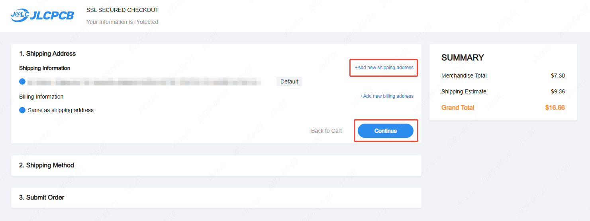

## Ordering from JLCPCB

For more details, see the JLCPCB suport page here: [https://jlcpcb.com/help/article/how-do-i-place-an-order](https://jlcpcb.com/help/article/how-do-i-place-an-order)

1) Download the release files here: [epd-pcb-ruler-gerbers-R2.zip](https://github.com/kaine119/epd-pcb-ruler/releases/download/r2/epd-pcb-ruler-gerbers-R2.zip)
2) Go to [jlcpcb.com](https://jlcpcb.com) and, on the top right, click sign in, or create a new account if you don't have one.
2) Click "Order now". 

    

3) Drag the .zip file into the box to upload it.

    

    *(click to enlarge)*

4) Select the options shown above:

    * Qty: as needed
    * PCB color: black
    * Surface finish: ENIG (for gold plating)

    The rest of the options can be left as default.

5) Click Save to Cart. You should be brought to a cart page:

    

    To edit the order (e.g. to change colour or increase the order qty), click Edit Order to go back to the order page.

    From here you can also click the dropdown next to "Shipping estimated" to preview the total cost and view prices for different shipping methods (useful for quotations). Prices shown are in USD.

    

6) When you're ready, click the Checkout button. Fill in a shipping address and billing details, then select a shipping and payment method.

    